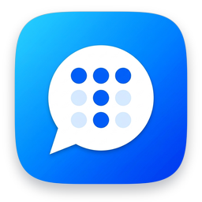
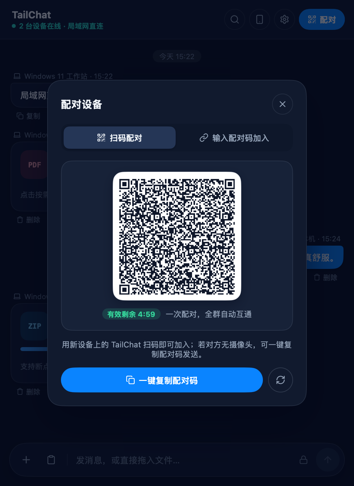
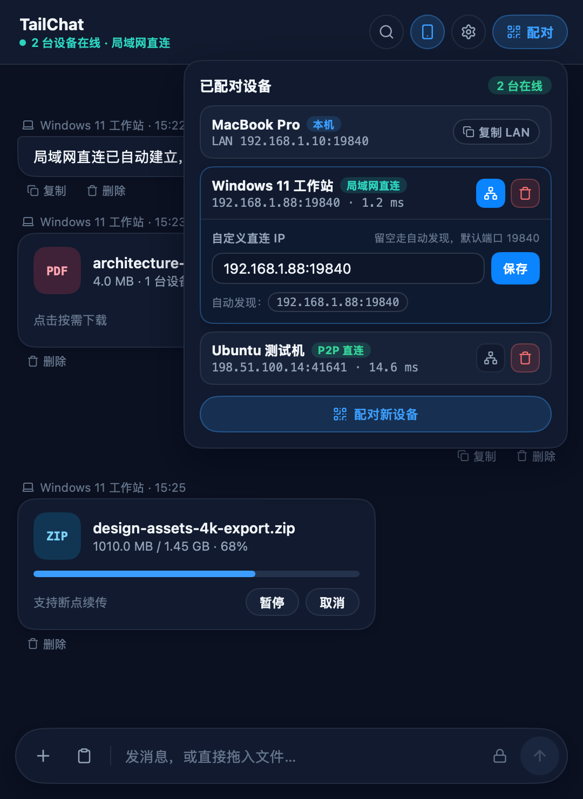
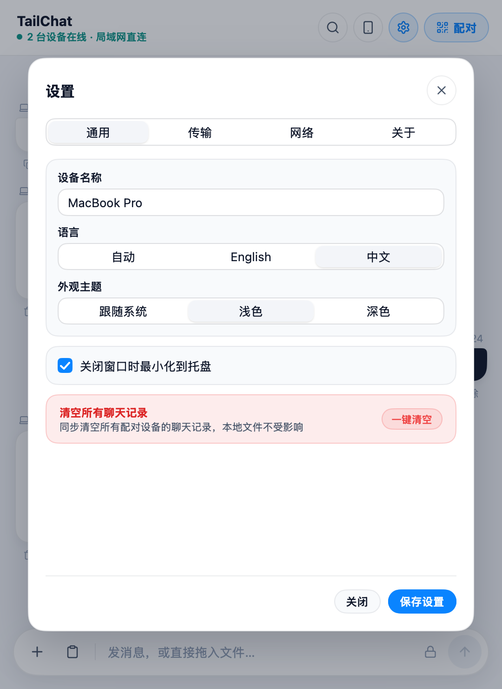

<div align="center">



# TailChat

**Account-free, pure-Go native P2P file & text transfer across all your devices**

Built with [**MyGo**](https://github.com/egoist/mygo) GPU-native UI · [**Tailscale Tailcat**](https://github.com/tailscale/tailcat) userspace WireGuard tunnels

[](https://github.com/jae-jae/tailchat/releases/latest)
[](https://go.dev/)
[](#highlights)
[](#highlights)
[](LICENSE)

English | [简体中文](README.zh-CN.md)

<br />


</div>

---

## Highlights

- **Zero Accounts, Full-Mesh P2P**: Every device generates local WireGuard + Ed25519 keys with no central control plane. All paired devices share one unified timeline — instant text sync and on-demand or threshold-based file transfer.
- **4-Tier Intelligent Direct Transport**: Automatically selects the fastest encrypted path — **Custom Direct IP (TCP+mTLS)** → **Auto-Discovered LAN Direct (TCP+mTLS)** → **Tailcat UDP P2P Direct** → **DERP Relay**. Configure per-peer direct IPs inline inside the Devices popover for instant hot session upgrades, or hot-swap to your own `derper` / custom `DERPMapURL` at any time **without losing paired devices**.
- **QR Code Pairing, Mesh-Wide Sync**: Click **Pair** in the toolbar to generate a pure-Go QR code (with white quiet-zone preservation in dark mode) or copy the pairing code in one click. Signed membership events gossip across your group automatically; revoke any device anytime to sever its tunnel immediately.
- **Resumable Large-File Transfers & Rich Media Previews**: 1 MiB BLAKE3 content-addressed chunks with persistent bitmaps and automatic CAS reclamation — pause, resume, cancel, rate-limit, and pull concurrently across multiple online peers. Includes inline image thumbnails with fullscreen lightbox, inline audio playback, custom download folder, and one-click **Show in Folder**.
- **Pure-Go GPU-Native Client (Light/Dark & Bilingual)**: Zero Electron / WebView overhead. Features **Zen Popover (Light)** and **Zen Slate (Dark)** themes with `System / Light / Dark` live preview, auto-detected **English / 简体中文** UI, Floating Capsule composer, 4-tab Settings, platform-native window chrome (macOS traffic lights; two-tier `32px` titlebar + `48px` toolbar on Windows & Linux), system tray, global `Cmd/Ctrl+Shift+T` hotkey, drag-and-drop / clipboard paste, and SQLite WAL + FTS5 full-text search.
- **Signed Auto-Updater & Multi-Platform Releases**: Built-in signed in-app updater with delta updates and release notes (`Settings → About`), plus automated releases for macOS, Windows, Linux, and headless nodes.
- **Headless Always-On Node & Mobile Extensions**: Ships with `tailchat-headless` for NAS / Mac mini / VPS caching, plus an Android foreground-service/share plugin and a pure-Swift iOS Share Extension.

## Screenshots

<table>
  <tr>
    <td align="center" width="50%">
      <br />
      <sub><b>QR Pairing & One-Click Copy (Zen Slate Dark)</b></sub>
    </td>
    <td align="center" width="50%">
      <br />
      <sub><b>4-Tier Direct Paths & Inline Custom Direct IP</b></sub>
    </td>
  </tr>
  <tr>
    <td align="center" width="50%">
      <br />
      <sub><b>4-Tab Settings: Bilingual & Light / Dark Theme Switcher</b></sub>
    </td>
    <td align="center" width="50%">
      <br />
      <sub><b>LAN Direct Listen & Self-Hosted DERP Hot-Switch</b></sub>
    </td>
  </tr>
</table>

## Download & Quick Start

### Download Prebuilt Packages

Grab the latest signed binaries from [**GitHub Releases**](https://github.com/jae-jae/tailchat/releases/latest) (verified via `SHA256SUMS.txt`):

| Platform | Architectures | Packages |
| --- | --- | --- |
| **macOS** | `arm64`, `amd64` | `.dmg`, `.tar.gz` |
| **Windows** | `amd64`, `arm64` | `-setup.exe` installer, portable `.zip` |
| **Linux** | `amd64`, `arm64` | `.deb`, `.rpm`, `.tar.gz` |
| **Headless CLI** | Linux / macOS / Windows | `tailchat-headless` `.tar.gz` / `.zip` |

Click **Pair** in the top-right corner of an existing device, then scan the QR code or paste the pairing code on a new device to join your mesh.

### Build from Source

Requires **Go 1.27.4+**.

```bash
# 1. Build desktop app & headless node
go build -o ./tailchat ./cmd/tailchat
go build -o ./tailchat-headless ./cmd/tailchat-headless

# 2. Launch desktop client (use distinct -data-dir to run multiple local instances)
./tailchat -data-dir ~/.tailchat -name "MacBook Pro"

# 3. Run the full test suite
go test -race ./...
```

<details>
<summary><b>Optional: Headless Always-On Node (NAS / Linux / VPS) & Mobile Builds</b></summary>

```bash
# Join your device group and auto-cache files up to 200 MB
./tailchat-headless \
  -data-dir ~/.tailchat-headless \
  -name "HomeNAS" \
  -join "tailchat-pair://..." \
  -auto-download-mb 200

# Or generate a one-time pairing code from a headless node
./tailchat-headless -data-dir ~/.tailchat-headless -name "HomeNAS" -pair

# Use a self-hosted derper node or custom DERPMap URL
./tailchat-headless -data-dir ~/.tailchat-headless -name "HomeNAS" -derp-host derp.example.com
```

For Android / iOS builds, see [`mygo.json`](mygo.json) and [`ios/ShareExtension/README.md`](ios/ShareExtension/README.md):

```bash
go tool mygo build -platform android
go tool mygo build -platform ios
```

</details>

## Project Structure

```text
cmd/
├── tailchat/             # MyGo desktop & mobile app entry point
└── tailchat-headless/    # Zero-UI always-on caching node CLI
internal/
├── model/                # Domain models, Ed25519 / BLAKE3 / ULID & contracts
├── store/                # SQLite WAL + FTS5 store & 1 MiB BLAKE3 chunk CAS
├── transport/            # Tailcat mesh, LAN/Custom-IP TCP+mTLS direct & yamux muxing
├── syncproto/            # Signed membership gossip, pairing, vector clock & downloader
├── updater/              # Signed in-app auto-updater, delta patches & release notes
└── ui/                   # MyGo GPU-native UI, Light/Dark themes, i18n, QR, media & tray
plugins/mobilebridge/     # Android (Kotlin) / iOS (Swift) native bridge plugin
ios/ShareExtension/       # Pure-Swift iOS Share Extension (zero Go dependency)
```

## License

[MIT](LICENSE) © 2026 [jae-jae](https://github.com/jae-jae)
