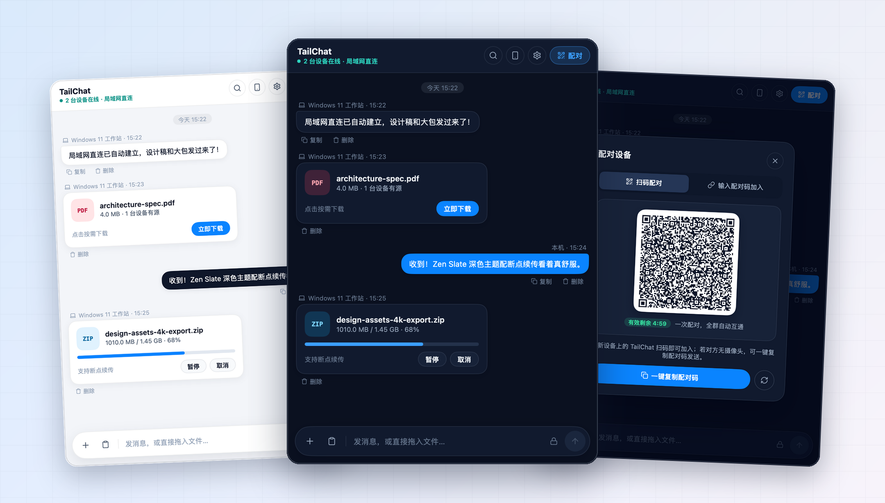
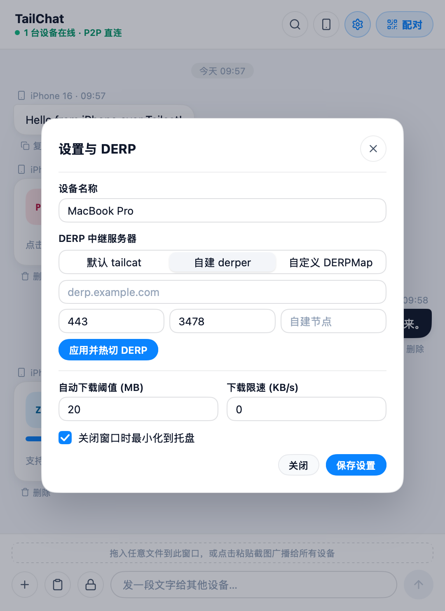

<div align="center">


# TailChat

**Account-free, pure-Go native P2P file & text transfer across all your devices**

Built with [**MyGo**](https://github.com/egoist/mygo) GPU-native UI · [**Tailscale Tailcat**](https://github.com/tailscale/tailcat) userspace WireGuard tunnels

[](https://go.dev/)
[](#highlights)
[](#highlights)
[](LICENSE)

English | [简体中文](README.zh-CN.md)

<br />



</div>

---

## Highlights

- **Zero Accounts, Full-Mesh P2P**: Every device generates local WireGuard + Ed25519 keys with no central control plane. All paired devices share one unified timeline — instant text sync and on-demand or threshold-based file transfer.
- **QR Code Pairing, Mesh-Wide Sync**: Click **Pair** in the top bar to generate a pure-Go QR code (or copy the pairing code in one click). Signed membership events gossip across your group automatically; revoke any device anytime to sever its tunnel immediately.
- **Works Out of the Box + Hot-Swappable Self-Hosted DERP**: Bootstraps via `tailcat.dev` and upgrades to direct LAN/NAT P2P connections automatically. Switch to your own `derper` or custom `DERPMapURL` at any time **without losing paired devices**.
- **Resumable Large-File Transfers**: 1 MiB BLAKE3 content-addressed chunks with persistent chunk bitmaps — pause, resume, cancel, rate-limit, and pull concurrently across multiple online peer devices.
- **Pure-Go GPU-Native Client**: Zero Electron / WebView overhead. Includes system tray integration, global `Cmd/Ctrl+Shift+T` hotkey, drag-and-drop / clipboard paste sending, and SQLite WAL + FTS5 full-text search.
- **Headless Always-On Node & Mobile Extensions**: Ships with `tailchat-headless` for NAS / Mac mini / VPS caching, plus an Android foreground-service/share plugin and a pure-Swift iOS Share Extension.

## Screenshots

<table>
  <tr>
    <td align="center" width="33.3%">
      <br />
      <sub><b>QR Pairing & One-Click Copy</b></sub>
    </td>
    <td align="center" width="33.3%">
      <br />
      <sub><b>Lightweight Devices Popover (Direct / Relay)</b></sub>
    </td>
    <td align="center" width="33.3%">
      <br />
      <sub><b>Self-Hosted DERP Hot-Switch & Transfer Controls</b></sub>
    </td>
  </tr>
</table>

## Quick Start

Requires **Go 1.27.4+**.

```bash
# 1. Build desktop app & headless node
go build -o ./tailchat ./cmd/tailchat
go build -o ./tailchat-headless ./cmd/tailchat-headless

# 2. Launch desktop client (use distinct -data-dir to run multiple local instances)
./tailchat -data-dir ~/.tailchat -name "MacBook Pro"

# 3. Run the full test suite
go test -race ./...
```

Click **Pair** in the top-right corner of an existing device, then scan the QR code or paste the pairing code on a new device to join your mesh.

<details>
<summary><b>Optional: Headless Always-On Node (NAS / Linux / VPS) & Mobile Builds</b></summary>

```bash
# Join your device group and auto-cache files up to 200 MB
./tailchat-headless \
  -data-dir ~/.tailchat-headless \
  -name "HomeNAS" \
  -join "tailchat-pair://..." \
  -auto-download-mb 200

# Use a self-hosted derper node
./tailchat-headless -data-dir ~/.tailchat-headless -name "HomeNAS" -derp-host derp.example.com
```

For Android / iOS builds, see [`mygo.config.ts`](mygo.config.ts) and [`ios/ShareExtension/README.md`](ios/ShareExtension/README.md):

```bash
mygo build -platform android
mygo build -platform ios
```

</details>

## Project Structure

```text
cmd/
├── tailchat/             # MyGo desktop & mobile app entry point
└── tailchat-headless/    # Zero-UI always-on caching node CLI
internal/
├── model/                # Domain models, Ed25519 / BLAKE3 / ULID & contracts
├── store/                # SQLite WAL + FTS5 store & 1 MiB BLAKE3 chunk CAS
├── transport/            # Tailcat 1-Server + Pairwise Client + yamux muxing
├── syncproto/            # Signed membership gossip, pairing, vector clock & downloader
└── ui/                   # MyGo GPU-native UI, pure-Go QR renderer & tray integration
plugins/mobilebridge/     # Android (Kotlin) / iOS (Swift) native bridge plugin
ios/ShareExtension/       # Pure-Swift iOS Share Extension (zero Go dependency)
```

## License

[MIT](LICENSE) © 2026 [jae-jae](https://github.com/jae-jae)
