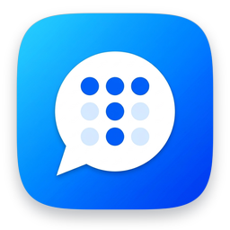
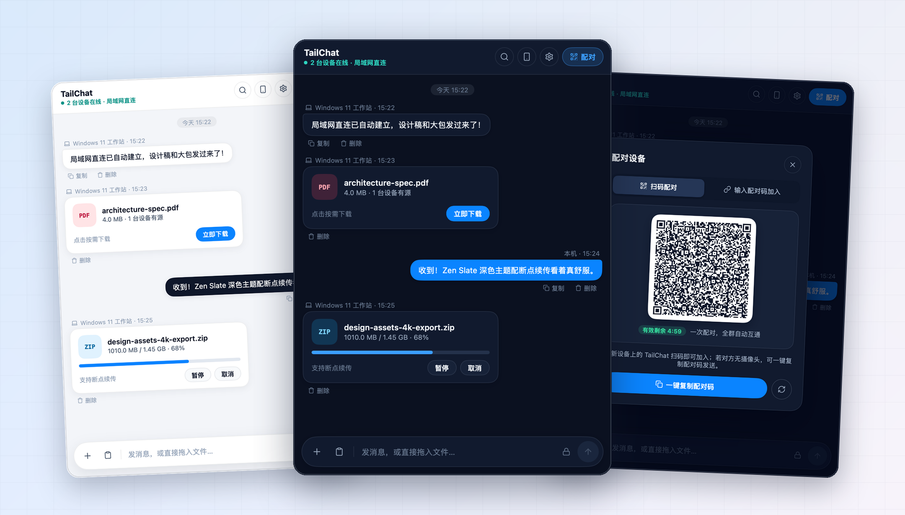
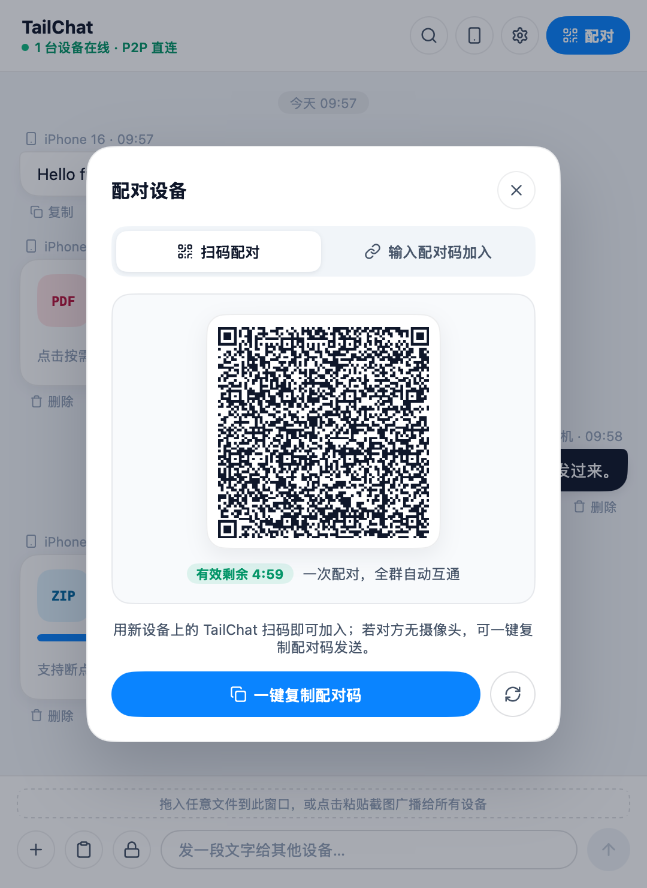
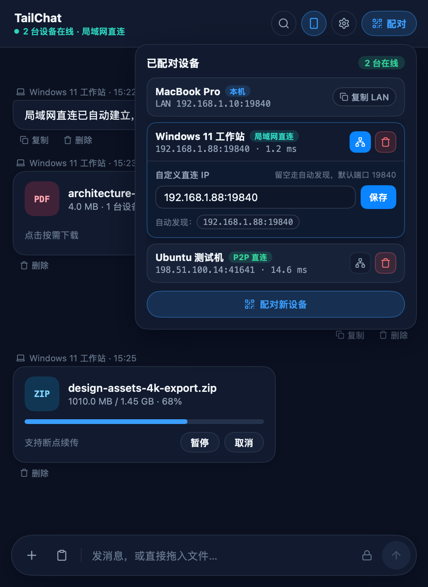
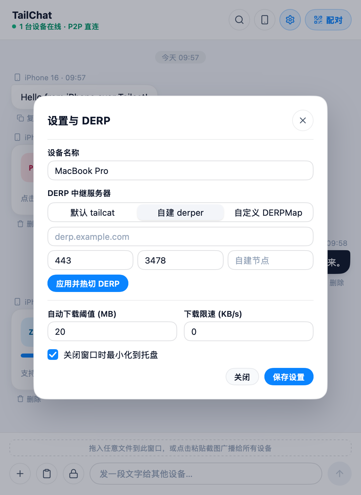

<div align="center">



# TailChat

**零账号、纯 Go 原生界面的跨平台多设备 P2P 文件与文字传输助手**

基于 [**MyGo**](https://github.com/egoist/mygo) GPU 自绘原生界面 · [**Tailscale Tailcat**](https://github.com/tailscale/tailcat) 纯用户态 WireGuard 加密隧道

[](https://go.dev/)
[](#核心特性)
[](#核心特性)
[](LICENSE)

[English](README.md) | 简体中文

<br />



</div>

---

## 核心特性

- **零账号全互联**：每台设备本地生成 WireGuard + Ed25519 密钥，无中心控制面；所有已配对设备共享同一条「我的设备群」时间线，文字秒同步，文件按需或按阈值自动拉取。
- **扫码即配对，一次加入全群互通**：点击顶部 **配对** 生成高对比纯 Go 二维码（支持一键复制配对码），签名成员事件自动 Gossip 扩散至群内所有设备；支持随时一键踢出并即时断开隧道。
- **开箱即用 + 热切换自建 DERP**：默认通过 `tailcat.dev` 引导并在局域网/公网打洞后自动升级 P2P 直连；设置页随时切换自建 `derper` 或自定义 `DERPMapURL`，**更换 DERP 不掉配对**。
- **大文件分块断点续传**：1 MiB BLAKE3 内容寻址分块 + 持久化位图，支持暂停/恢复/取消、限速及跨多台在线己方设备并发拉取。
- **纯 Go GPU 原生客户端**：零 Electron / 零 WebView 内存开销；集成系统托盘、`Cmd/Ctrl+Shift+T` 全局唤出、拖拽/粘贴发送与 SQLite WAL + FTS5 全文检索。
- **无头节点 & 移动端扩展**：提供零 UI 的 `tailchat-headless` 常驻节点（适合 NAS / Mac mini / VPS），以及 Android 前台保活/分享插件与纯 Swift iOS Share Extension。

## 界面预览

<table>
  <tr>
    <td align="center" width="33.3%">
      <br />
      <sub><b>扫码配对 & 一键复制</b></sub>
    </td>
    <td align="center" width="33.3%">
      <br />
      <sub><b>轻量设备浮层（直连 / 中继状态）</b></sub>
    </td>
    <td align="center" width="33.3%">
      <br />
      <sub><b>自建 DERP 热切换与传输策略</b></sub>
    </td>
  </tr>
</table>

## 快速开始

需要 **Go 1.27.4+**。

```bash
# 1. 编译桌面端与无头节点
go build -o ./tailchat ./cmd/tailchat
go build -o ./tailchat-headless ./cmd/tailchat-headless

# 2. 启动桌面端（本地双开可指定不同 -data-dir）
./tailchat -data-dir ~/.tailchat -name "MacBook Pro"

# 3. 运行全仓测试
go test -race ./...
```

在已有设备点击右上角 **配对**，用新设备扫码或粘贴配对码即可完成组网。

<details>
<summary><b>可选：部署常驻无头节点（NAS / Linux / VPS）与移动端构建</b></summary>

```bash
# 加入设备群并自动缓存 ≤ 200 MB 的文件
./tailchat-headless \
  -data-dir ~/.tailchat-headless \
  -name "HomeNAS" \
  -join "tailchat-pair://..." \
  -auto-download-mb 200

# 指定自建 derper 节点
./tailchat-headless -data-dir ~/.tailchat-headless -name "HomeNAS" -derp-host derp.example.com
```

移动端（Android / iOS）参考 [`mygo.json`](mygo.json) 与 [`ios/ShareExtension/README.md`](ios/ShareExtension/README.md)：

```bash
go tool mygo build -platform android
go tool mygo build -platform ios
```

</details>

## 仓库结构

```text
cmd/
├── tailchat/             # MyGo 桌面/移动主程序
└── tailchat-headless/    # 无头常驻缓存节点 CLI
internal/
├── model/                # 领域模型、Ed25519 / BLAKE3 / ULID 与接口契约
├── store/                # SQLite WAL + FTS5 存储与 1 MiB BLAKE3 分块 CAS
├── transport/            # Tailcat 1-Server + Pairwise Client + yamux 多路复用
├── syncproto/            # 签名成员 Gossip、配对、Vector Clock 同步与续传下载器
└── ui/                   # MyGo GPU 原生界面、纯 Go 二维码与系统托盘集成
plugins/mobilebridge/     # Android (Kotlin) / iOS (Swift) 原生桥接插件
ios/ShareExtension/       # 纯 Swift iOS Share Extension（零 Go 依赖）
```

## License

[MIT](LICENSE) © 2026 [jae-jae](https://github.com/jae-jae)
